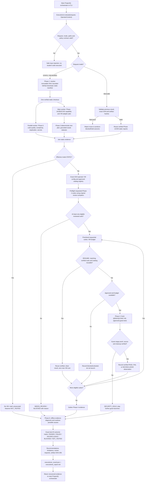

# ProjectIQ — Version 1.4 Executioner Agent Technical Development Log

**Document type:** Detailed engineering/development log, architecture reference, capability inventory, validation record, limitations and roadmap  
**Version:** **1.4** (ProjectIQ documentation version; distinct from internal module/report schema versions)  
**Component:** `projectiq_executioner/`  
**Repository / branch:** `VarunRGB/ProjectIQ` / `executioner`  
**Implementation revision inspected:** `2ae8e10bd3d9bced07bb2b587122b18917ec07f3`  
**Compiled:** 24 November 2026  
**Status:** Executioner MVP implemented and cross-stack **reviewed readiness** validated; feature-level completeness, independent untrusted-code security attestation and final multi-agent integration remain open.

> **Version boundary.** This document follows `logs/version_1_baseline.md`, `logs/version_1.1_baseline.md`, and `logs/version_1.3_research_agent_change_log.md`. The v1.4 designation covers the Executioner development round, not Phase 5's internal v0.3.1 or the orchestrator's v0.1 output contract. Historical documents are not retroactively renumbered.

> **Critical interpretation.** **Recognized** technology, **runnable** architecture and **functionally verified** features are three different levels of support. A planned test is not an executed test. An HTTP 200 startup check is not complete application verification. No part of the reviewed pilot establishes that the QEMU sandbox is independently attested for arbitrary untrusted student submissions.

---

## Executive summary

Executioner is the software assessment subsystem of ProjectIQ. It accepts a public GitHub repository as a pinned immutable commit, builds a detailed static understanding of the architecture and code, determines which portions can be exercised in a curated Linux VM, discovers grounded test specifications, performs only independently approved functional checks, analyzes code quality, interprets the resulting evidence conservatively and returns a comprehensive structured result for the main ProjectIQ orchestrator and teacher dashboard.

The central Version 1.4 achievement is a **single-call, capability-aware orchestrator** at `projectiq_executioner.orchestration.evaluate(...)`. Instead of requiring the main ProjectIQ orchestrator to call numbered phases itself, Executioner chooses a dependency-driven workflow. Its three modes are `STATIC`, `REVIEWED` and `RESUME`. Executioner returns a structured handoff for the future main ProjectIQ controller and teacher-facing UI; that broader multi-agent integration is outside this Version 1.4 Executioner MVP.

**Observed Windows/QEMU one-call acceptance, 24 November 2026:** one approved **HTTP readiness** suite passed, with verified VM cleanup, for each of four adapters: native PHP/MySQL MiniCollab, static HTML FSDL, React/Vite, and Python/Flask. These are real approved-VM pilot observations, not synthetic-only test results. They demonstrate reliable cross-stack startup orchestration, **not** comprehensive project-functionality coverage. Most deeper scenarios still need their independently reviewed catalogs wired through the one-call operator registry.

### Capability overview

| Subsystem | Implemented capability | Interpretation / remaining boundary |
|---|---|---|
| Phase 1 | Public GitHub ingestion, SHA pinning, source and technology discovery, manifest | Static inference only; source may contain dynamic constructs that escape recognition |
| Phase 2 | Capability planning and six constrained QEMU runtime adapters | Restricted to exact operator-approved SHAs and pinned runtime assets |
| Phase 3 | Deterministic test discovery and grounded specifications | `NEEDS_ORACLE` means not executable as a trustworthy behavioral test |
| Phase 4 | Ten reviewed functional suite kinds, including API/auth/DB/CRUD/browser pilots | Narrow approved oracles; not generic arbitrary test-code execution |
| Phase 5 | Code metrics, limited complexity/duplication/lint, potential secret indicators | Provisional maintainability indicator, **never** a grade |
| Phase 6 | Offline failure triage and cautious root-cause hypotheses | Student defect **NOT_ESTABLISHED** without independent proof |
| Executioner orchestrator | Three-mode API, parallelizable static work, registry and resume, full report | Tested on four real readiness adapters; deeper all-suite one-call acceptance pending |

### Technical foundation

- **Language and analysis:** Python 3.11+ (development on Windows 11, Python 3.13); Python standard-library modules including `pathlib`, `json`, `hashlib`, `re`, `ast`, collections, dataclasses, and `ThreadPoolExecutor`. No LLM schedules phases or invents runnable tests.
- **Ingestion:** HTTPS GitHub repository URLs resolved to a 40-character commit SHA; bounded ZIP download and safe archive extraction.
- **Execution:** QEMU with a pinned Ubuntu Linux image and disposable QCOW2 overlay. Windows WHPX and OpenSSH loopback controller are used where configured. No Docker/Podman runtime prerequisite in the current VM path.
- **Dependency handling:** SHA-pinned Linux Node/npm artifacts and Python wheelhouses, optionally prepared in separate **explicitly authorized** networked disposable VMs. Normal student execution VMs use offline caches.
- **Browser:** Pinned Chrome/Chromium and bounded CDP interaction **inside** the VM for reviewed UI rendering cases.
- **Databases:** Guest-local MySQL for curated PHP and SQLite for eligible Python/Node shapes; no production database access.
- **Trust:** Exact source and catalog identity, operator allowlists, bounded guest results, guest validation, VM cleanup, evidence SHA-256 and explicit security limitations.
- **Output:** Versioned JSON, Markdown and hashed evidence artifacts, including per-test-case results and reasons for missing coverage.

---

## 1. Phase 1 — Immutable GitHub ingestion and repository intelligence

### Purpose and inputs

Phase 1 identifies **what the repository appears to contain** without importing, installing, building or running any of its code. Standalone CLI: `python -m projectiq_executioner <public-repository-url> --out <directory>` (also supports explicitly supplied local folders). The Version 1.4 orchestrator accepts public HTTPS GitHub repository root URLs and reuses one pinned checkout for its static phases.

**Main files:** `github_client.py`, `safe_archive.py`, `indexer.py`, `analyzer.py`, `models.py`, `report.py`, `MANIFEST_CONTRACT.md`, and `NOMENCLATURE_COVERAGE.md`. Schema `1.0`; principal artifacts `phase1/manifest.json` and `phase1/manifest.md`.

### Source types and languages recognized

The filename inventory maps `.py` to Python; `.js/.jsx/.mjs/.cjs` to JavaScript; `.ts/.tsx` to TypeScript; `.php` to PHP; `.html/.htm` to HTML; `.css/.scss/.sass` to stylesheet languages; `.java` to Java; `.kt/.kts` to Kotlin; `.go` Go; `.rs` Rust; `.rb` Ruby; `.cs` C#; `.c/.h/.cpp/.cc/.cxx/.hpp` C/C++; `.graphql/.gql` GraphQL; `.proto` Protocol Buffers; `.swift` Swift; `.dart` Dart; `.sql` SQL; `.vue` Vue; `.svelte` Svelte; `.ipynb` Jupyter; `.sh` shell and `.ps1` PowerShell. **These are detectable source types, not all runnable runtimes.**

The dependency recognizer looks for major ecosystems: React, Vite, Next.js, Vue, Nuxt, Angular, Svelte/SvelteKit, Express, Fastify, NestJS, Koa, Hono, Flask, FastAPI, Django, Starlette, Streamlit, Gradio, Laravel and related platforms. It also recognizes candidate storage and supporting libraries such as MySQL, MariaDB, SQLite, PostgreSQL, MongoDB, Redis, Prisma, Sequelize, TypeORM, Drizzle, SQLAlchemy, and selected SDKs/API clients. Common test framework signals include pytest, unittest, Jest, Vitest, Playwright, Cypress, Mocha, Supertest and PHPUnit.

### Route and feature discovery

The recognizers cover literal Express/Koa routers and mounts, Fastify and Hono methods, NestJS decorators, Next.js App and Pages routes, SvelteKit and Nuxt routing, Flask/FastAPI decorated functions/router prefixes, Django URL declarations, selected Spring and ASP.NET controllers, Laravel and PHP file endpoints, Go net/http and selected framework forms, Rails route declarations, and Rust Actix/Axum route patterns.

Frontend inspection includes Next/Nuxt/SvelteKit pages, literal React Router/Vue Router/Angular routes, HTML forms, fetch/axios/ky, Angular HttpClient, Python requests/httpx and limited literal template/ternary URL alternatives. The analyzer recognizes basic OpenAPI/Swagger endpoints, GraphQL operations and gRPC methods as **distinct kinds of API evidence**; GraphQL RPCs are never silently converted to HTTP routes.

Outputs also record file roles, logical service candidates, route methods and paths, frontend/backend API correlations, inventory counts, setup/configuration files, detected test artifacts, entrypoints, database schemas, environment **variable names**, README feature candidates, source line evidence, findings, uncertainty and confidence. A feature claimed in README is *documented*, not proven operational.

### How Phase 1 is implemented

1. Validate a public GitHub root URL and resolve the requested ref to an immutable SHA.
2. Download a bounded ZIP; reject oversized, unsafe, traversing or unsupported archive entries.
3. Extract to a temporary checkout and build an index while skipping expected dependency/build noise and unsafe files.
4. Parse known manifests and inspect bounded source text with deliberately conservative recognizers.
5. Convert observations to dataclass models, stable source/evidence records and an escaped human-readable manifest.
6. Return source identity and manifest to downstream stages without running student code.

### Limitations and future upgrades

The static recognizer cannot infer every dynamic router, arbitrary imports, framework runtime rewriting, hidden environment configuration, deployment topology, real web responses, feature correctness or full dependency behavior. False negatives are possible. Proposed expansions: deeper parser/AST coverage, additional routing conventions, monorepo graph analysis, private GitHub ingestion through an explicit authorized provider, and measurable recall/precision benchmarks on diverse repositories.

---

## 2. Phase 2 — Architecture planning, approved runtimes and VM security

### 2.1 Internal Phase 2 architecture

**Phase 2A** (`phase2/planner.py`) builds a non-executing logical service and dependency plan. **Phase 2B** (`phase2/preflight.py`) checks topology and ordering, dependency/configuration gaps, database schema risks, engine availability hints and other blockers; older Docker/Podman probes are historical, not authoritative for the native VM pathway. **Phase 2C** (`phase2/vm_worker/contracts.py`, `orchestrator.py`, `qemu.py`) builds strict source-bound execution candidates and implements the disposable QEMU worker. **Phase 2D** (`phase2/phase2d/`) adds detailed adapter profiles and capability gap reports, offline dependency preparation, and an earlier **startup-only** one-call API. The full Version 1.4 evaluator is instead `orchestration/`.

Planning results describe what *might* run; they never authorize a VM launch. A selected adapter and status `CANDIDATE_NEEDS_VM_VERIFICATION` still require exact-SHA review, runtime assets, host tools and guest controls.

### 2.2 Actual executable adapter families

| VM adapter | Runnable project architecture | Readiness behavior | Prerequisites / notable exclusions |
|---|---|---|---|
| `static_html_v1` | One static web frontend with evidenced `index.html` | Guest checks `/index.html` | No general SPA build, backend or dynamic browser interactions |
| `php_mysql_v1` | Native PHP backend, at most one static frontend, one MySQL/MariaDB service and reviewed SQL schema | Guest serves reviewed page/probe | Narrow PHP/MySQL layout, no blanket Laravel support |
| `node_vite_offline_v1` | Standalone Vite frontend, including React/Vite | Guest offline build, static HTTP readiness | npm `package-lock.json`, pinned Node/cache; no Yarn/pnpm/Bun/Next.js |
| `python_web_offline_v1` | One Flask **or** FastAPI service with optional cohosted static UI and optional SQLite | Flask `GET /`; FastAPI `/openapi.json` | Pinned simple requirements, wheelhouse, fixed Python web entrypoint |
| `node_express_offline_v1` | One Express backend with literal health endpoint | HTTP/JSON readiness at `/`, `/health` or `/api/health` | Reviewed server entrypoint and npm cache; no external DB/cloud services |
| `node_fullstack_offline_v1` | Exactly one Vite frontend plus Express backend in separate safe roots; optional Node SQLite | Built frontend, backend health and bounded proxy/API checks | Both lockfiles and route correlations required; not arbitrary microservices |

**Recognition ≠ execution.** The detector might recognize Java/Spring, Django, Next.js, PostgreSQL, MongoDB, GraphQL and other stacks; no corresponding generic runnable adapter is implied. Even a known adapter works only for its **specific constrained project shape**. The user reported successful one-call readiness for the first four adapter types above, but not a Version 1.4 full one-call trial for Express-only or Node full-stack in this acceptance sequence.

### 2.3 Offline dependency strategy

For Vite/Express, a pinned **Linux Node.js 24.x** runtime, exact npm lockfile hashes and SHA-256-pinned dependency cache are used. A separately approved and isolated preparation VM may have temporary controlled network access to fetch packages with lifecycle scripts disabled (`npm ci --ignore-scripts`). The normal execution VM is offline, installs with `npm ci --offline --ignore-scripts`, and starts only the reviewed fixed entrypoint/build tool. It does not execute arbitrary user-provided npm scripts on Windows.

For Flask/FastAPI, the Ubuntu guest provides Python 3.12; an approved pip wheel and binary-only wheelhouse are prepared separately. The runtime VM uses `--no-index` and a bounded fixed launcher. Optional SQLite state lives in disposable guest storage. For Vite+Express full stack, frontend and backend lockfiles are separately pinned and checked; Express runs on guest loopback, while the frontend is served through a trusted local server with a fixed restricted internal API proxy.

### 2.4 VM lifecycle, isolation and cleanup

1. Verify the exact `owner/repository@40-character-SHA` is in the operator-owned `vm_config.json` `approved_snapshots` list.
2. Independently check immutable candidate/source, Ubuntu base-image SHA-256, optional firmware, QEMU system/img utilities and SSH tools, supported accelerator and approved offline assets.
3. Create a fresh disposable QCOW2 overlay and managed leased workspace; use temporary control credentials and loopback-bound SSH.
4. Execute fixed guest-side commands under bounded resource and runtime policies, with outbound egress restricted and no direct host filesystem mounts.
5. Verify startup/probe result, underlying guest stage validation, host/guest provenance, process status and cleanup.
6. Stop VM, remove ephemeral overlay/storage and record a verified cleanup witness; otherwise raise a hold rather than claim execution passed.

Later Phase 2D hardening slices D5b/D5c/D5d addressed guest resource boundaries, process/core/cgroup checks, managed runtime lease/recovery, root filesystem and host path restrictions, Windows ACL/owner/job/port checks, and independent acceptance records. The D5e closeout explicitly separated *reviewed pinned pilot GO* from **arbitrary untrusted student execution NO_GO**. These controls are substantial but are **not external security attestation**.

### 2.5 Current boundaries and future work

Only manually reviewed immutable commits may execute. The trusted host needs QEMU, Ubuntu image, SSH, configured budgets, and correct hashes. External cloud services, arbitrary package managers, runtime downloads, Docker-only stacks, unsupervised script execution, generalized DB provisioning, and arbitrary multiproject deployments are not supported. A missing `qemu-system-x86_64` or `qemu-img` executable causes a **host preflight denial**, not a student failure. Future development must address independently validated sandbox isolation, more adapters, broader service graphs, safe provider mocks, reproducible image baking and resource-managed concurrency.

---

## 3. Phase 3 — Deterministic, source-grounded test generation

### Purpose and implementation

`phase3/generator.py`, `contracts.py`, `source_contracts.py` and `benchmark.py` convert a validated Phase 1 manifest plus an optional same-SHA Phase 2 candidate into `phase3/test_plan.json` (**schema 1.1**). They assign deterministic test IDs (`TC-` followed by sixteen uppercase hex characters), canonicalize targets, deduplicate recognized routes, bound output sizes and preserve evidence and missing prerequisites. The orchestrator can pass the **already-pinned checkout**, letting the generator inspect limited source contracts without redownloading.

**Categories:** `HTTP_READINESS`, `HTTP_ROUTE`, `UI_PAGE`, `NON_HTTP_API` and `PROGRAM_ENTRYPOINT`. This can include routes, UI pages, API declarations, source test artifacts, GraphQL/gRPC operations, executable-looking CLI entrypoints, and SQL/setup targets. Not all are runnable. The only broadly automatic behavioral oracle is the **adapter's readiness assertion** when Phase 2 provides a matched, grounded probe. Other expected responses may be derived only under specific source-backed contract rules or independently reviewed Phase 4 catalogs.

**Planning statuses:** `READY_FOR_PHASE4` means specification eligible for downstream handoff, **not permission**; `NEEDS_ORACLE` means no trusted expected result; `UNSUPPORTED_BY_RUNNER` means not executable with the current safe runner. Plan-level `GENERATED`, `DISCOVERY_ONLY`, `NO_TEST_TARGETS`, `INPUT_ERROR` describe the planning result, not whether the student's project works.

### How it is implemented and tested

Phase 3 validates Phase 1 schema/source and matching candidate SHA/adapter; reads bounded static evidence; assigns stable IDs by normalized category/method/target; issues a readiness-only grounded spec; preserves missing oracle reasons; validates the full schema and persists exclusively. Phase 3D/3E development added source-grounded contracts, richer nomenclature, deterministic ordering and cross-repository offline benchmark/contract mutation checks. The current generator does not use an LLM or execute any student program.

### Limitations and expansion

A README statement that users can “add tasks” does **not** supply trustworthy test inputs, authentication prerequisites, response values or DB postconditions. No arbitrary Java/C++ execution or generic UI/form driving occurs in this stage. Planned upgrades are reviewed OpenAPI fixtures, trusted requirements/invariants, safe property/metamorphic tests, fuller GraphQL/gRPC contracts, formal coverage tracking and optional **non-authorizing** LLM test suggestions.

---

## 4. Phase 4 — Operator-reviewed functional execution

### Architecture and meaning

Phase 4 moves from test candidates to actual checked behavior, but **only** after an original Phase 4 compiler binds the exact source, Phase 3 test IDs, catalog digest, approved runtime and operator policy. Guest-only operations test application behavior in disposable VMs; the host validates the bounded report and cleanup. A failed assertion means the application did not match the **reviewed expected value**; it does not, by itself, prove the student wrote a bug. Some historical negative acceptance tests intentionally supplied incorrect expected hashes or messages, which is why this distinction is crucial.

### Incremental implementation record

| Milestone | Implementation | Actual supported behavior / boundary |
|---|---|---|
| 4A | `handoff.py`, `guest_http.py` | Stage bounded Phase 3 ready tests, validate source, candidate and policy; **no VM** |
| 4B | `vm_run.py` and Phase 2 worker | Execute approved HTTP readiness/status/body checks; verify guest report and cleanup |
| 4C-A | `oracle_contracts.py`, `oracle_stage.py` | Produce independently reviewable functional oracle proposals and exact digest bindings |
| 4C-B | Phase 3 source-evidence/contract enhancements | Support limited source-backed expectations without guessing dynamic responses |
| 4C-C | `reviewed_api.py`, `api_vm_run.py` | Exact approved HTTP/API assertions inside guest |
| 4C-D1 | `db_fixture_*` | Bounded approved MySQL seed fixtures within disposable guest |
| 4C-D2 | `reviewed_auth.py`, `auth_vm_run.py` | Registration/login/error-path and session checks using disposable identities |
| 4C-D3 | `db_postcondition_*` | Guest read-only DB verification of narrow reviewed registration persistence |
| 4C-D4 | `scenario_isolation_*` | Two approved scenarios in separate disposable VMs; verify reset/teardown |
| 4C-D5 | `cross_repository_*` | Separate standalone pilot combining two reviewed repositories/VMs; **not** one-call suite kind |
| 4D-A | `dependent_workflow_*` | Approved dependent API steps and guest-generated task identifiers |
| 4D-B | `crud_workflow_*` | Reviewed MiniCollab CREATE→READ→UPDATE→READ→DELETE→READ + MySQL witness |
| 4D-C | `browser_ui_*`, `guest_browser_ui.py` | Guest Chrome/Chromium DOM checks after JS rendering; bounded CDP; no arbitrary clicking |
| 4D-D | `browser_login_*` | Narrow approved rendered login/session browser pilot |

### Ten suite kinds supported by the new one-call orchestrator

| Suite key | Required operator catalog key(s) | Report | Scope |
|---|---|---|---|
| `readiness` | None: Phase 3 readiness spec | `phase4_run.json` | Startup/HTTP smoke |
| `api` | `oracle` | `api_run.json` | Reviewed API expectations |
| `auth` | `auth`, `oracle` | `auth_run.json` | Reviewed auth/session HTTP paths |
| `db_fixture` | `fixture` | `db_fixture_run.json` | Guest database seed |
| `db_postconditions` | `auth`, `oracle`, `postconditions` | `d3_run.json` | Authenticated registration persistence |
| `scenario_isolation` | `auth`, `oracle`, `postconditions`, `isolation` | `d4_run.json` and nested guest reports | Two VM reset witnesses |
| `dependent_workflow` | `fixture`, `workflow` | `d4a_run.json` | Reviewed data-dependent API flow |
| `crud` | `auth`, `oracle`, `crud` | `d4b_run.json` | Narrow authenticated task CRUD |
| `browser_ui` | `browser` | `d4c_run.json` | DOM rendering/oracle check |
| `browser_login` | `login` | `d4d_run.json` | Reviewed login browser flow |

The reviewed catalog is **operator-owned**, and a matching SHA/Digest must appear in the existing review policy. A registry mapping is *not approval*. Several suites are deliberately specialized to MiniCollab or a constrained React/Vite+Express pilot. Successful readiness for another framework does not imply these suites apply to it.

### Verification and output

Each Phase 4 runner has its own guest report schema, approved source/adapter, guest validation marker, execution/cleanup evidence and failure categories. Normal suite calls use distinct disposable VM contexts; scenario-isolation costs two VM launches. A verified suite result may be `TESTS_PASSED`, `TESTS_FAILED`, `TESTS_INCONCLUSIVE`, `CRUD_PASSED/FAILED`, `BROWSER_PASSED/FAILED/INCONCLUSIVE`, etc.; the orchestrator normalizes these only after checking stage-specific proof. Missing cleanup, wrong SHA, unauthorized expectations and invalid guest evidence remain blocked or security-held.

### Current limitations / future expansions

The MVP does not automatically discover correct registration credentials, synthesize all application invariants, handle arbitrary authenticated full E2E flows, perform broad visual regression, test every SQL relationship or audit general application security. Browser support is bounded DOM verification in a reviewed VM, not a full Playwright/Cypress replacement. Future work: reusable per-stack/test oracle profiles, trusted feature-level fixtures, guarded browser interaction, independent DB state witnesses, broader API assertions, cross-repository test composition, coverage metrics and controlled reruns.

---

## 5. Phase 5 — Code quality, complexity, duplication and security indicators

### Implementation and supported analysis depth

`phase5/` is **static and read-only**. It reuses the bounded Phase 1 source indexer. Its modules include `source.py`, `functions.py`, `complexity.py`, `findings.py`, `duplication.py`, `security.py`, `scoring.py`, `pipeline.py`, `contracts.py`, `report.py`. Internal MVP release **v0.3.1**, report/scoring contract **v0.3**. The one-call orchestrator runs its Python analyzer on the verified checkout rather than invoking a second network fetch.

| Source type | Supported Phase 5 depth |
|---|---|
| Python | `ast`-based function/decision complexity, selected bounded Big-O patterns, lint and file metrics |
| JavaScript/TypeScript, PHP, C/C++ | Lexical/brace-based function discovery and **heuristic** complexity/smell checks, plus file metrics |
| Java, Go, Rust, Kotlin, C#, Swift, Ruby, Dart, Vue/Svelte, HTML/CSS/SQL/shell | Selected file-level metrics and secret/source indicators; no claim of full AST complexity |
| Small documentation/config formats | Selected potential-secret patterns under separate bounded read limits |

**Measured results:** physical/blank/comment/code line counts; analyzed/skipped/production/test file inventory; recognized function names and spans; bounded loop/branch nesting; selected conditional `O(1)`, `O(n)`, `O(m)`, `O(n+m)`, `O(n*m)`, `O(n²)`, `O(n log n)` patterns; exact/normalized repeated cross-file code blocks; selected fixed lint/advisory findings; potential hardcoded secret indicators, without exposing values.

Examples: Python mutable defaults, bare/empty `except`, wildcard imports, eval/exec and overly long functions; JS/TS `var`, `debugger`, loose equality, eval and console logs; PHP eval/legacy `mysql_query`/error suppression; C/C++ `gets`/`strcpy`/`sprintf` patterns; long files/lines. This is **not** full Ruff, ESLint, PHPStan, Clang-Tidy, formal security auditing, or measured runtime performance.

### Maintainability indicator — precise semantics

Nominal evidence dimensions are **lint 30%**, **complexity 30%**, **duplication 20%**, **structure 20%**. Only eligible measured dimensions contribute, with weights renormalized; unsupported AST coverage is *not* silently counted as perfect. Reports include `PROVISIONAL`, `PROVISIONAL_LIMITED` or `INSUFFICIENT_COVERAGE`, confidence, dimensions and coverage. Python AST coverage must meet internal gates before complexity contributes. Unknown Big-O is deliberately not penalized.

**Crucial example:** MiniCollab returned a provisional maintainability indicator of **100 with LOW confidence** in its static report. That means no deductions in the *eligible limited measured subset*; it **does not mean** the PHP project is perfect or should receive 100/100 academic marks. Independent reviewer calibration would be required before making stronger scoring claims.

The source guide documents bounded work, including up to approximately 12,000 indexed files, 2,000 analyzed source files, 350 KB per individual source file, 12 MB total, 5,000 functions and 750 reported quality findings. Hitting a cap or skipping unreadable files becomes a visible coverage limitation.

### Limitations and expansions

Complex recursion, dynamic dispatch, overloaded operators, framework calls, SQL/network/DOM behavior and unrecognized containers often have unknown complexity. Brace-language metrics may mistake literals for control structure. Duplication can include boilerplate and miss semantic equivalents. A suspected credential is not validated as a real leaked token. Planned improvements: robust language parsers, selectively pinned industry-standard linters, better duplication/complexity calibration and independent human maintainability ratings.

---

## 6. Phase 6 — Offline diagnosis, triage and evidence correlation

### Purpose and implementation

`phase6/` reads Phase 3 plans, reviewed Phase 4 run reports plus paired VM proof, optional Phase 5 quality output and explicitly declared test dependencies. It **does not** launch VMs, import student code, access GitHub, run a browser or produce new assertions. Modules: `contracts.py`, `evidence.py`, `catalog.py`, `dependencies.py`, `pipeline.py`, `report.py`. Output `phase6_diagnosis.json` and `.md`, schema **0.1**.

It validates source SHA/adapter/stage, strict bounded JSON, evidence receipts, test IDs, count consistency, guest markers and cleanup. It distinguishes planned tests from actual observations. It supports reviewed HTTP/API, browser UI/login, auth/DB persistence, CRUD and dependent workflow aggregates within bounded schema adapters; complex scenario-isolation and standalone cross-repository aggregate pilots have conservative/partial normalization.

### Diagnosis model

- **Observation:** a verified or unverified `PASS`, `FAIL`, `INCONCLUSIVE`, `BLOCKED`, `UNTESTED` or `INVALID_TEST`, with provenance and test/oracle context.
- **Diagnosis:** fixed-safe categories, severity/priorities and recommendations; no student-sourced raw exception prose.
- **Hypothesis:** possible root causes, with `cause_established=false` and **no automatically established student defect**.
- **Dependency groups:** only operator-supplied validated edges; a downstream failed result is never casually reclassified as blocked.
- **Historical comparison:** only source/test/catalog-compatible runs; environment equivalence is **not** independently attested.
- **Security precedence:** invalid execution/cleanup provenance triggers `SECURITY_HOLD`, suppresses overconfident student attribution and stops additional guest runs.

Priority is investigative: `P0` for security/cleanup, `P1` infrastructure/evidence/secret indicator, `P2` reviewed mismatch/missing oracle/inconclusive, `P3` unsupported/advisory. It is **not** grading severity.

### Limitations and future scope

No generic causality engine, no automatic proof of why HTTP 401 or 500 occurred, no raw compiler-log parsing, no independent malicious report signing and no automatic fault attribution. A reviewed expected result itself can be wrong. Future work: controlled known-cause labels, richer dependency maps, better cross-run environment equivalence, diagnostic precision validation and explicit evidence-linked fault triage.

---

## 7. The Version 1.4 one-call Executioner orchestrator

### Design, modules and input contract

| Source file | Responsibility |
|---|---|
| `orchestration/__init__.py` | Public `evaluate` and `OperatorContext` API |
| `orchestration/contracts.py` | Strict request/schema/source validation, bounded JSON, SHA digests and evidence policies |
| `orchestration/adapters.py` | Direct reuse of Phases 1, 2, 3, 5, 6; shared pinned static checkout |
| `orchestration/runners.py` | Fixed allowlisted Phase 4 compiler/runner bindings; exact catalog inputs |
| `orchestration/core.py` | Adaptive stage selection, source sync, limited parallelism, reviewed registry/preflights, VM budget, resume and aggregation |
| `orchestration/matrix.py` | Conservative exact-test-ID reconciliation of plans and execution |
| `orchestration/report.py` | Comprehensive escaped/redacted Markdown report |
| `orchestration/__main__.py` | CLI invoking the same `evaluate(...)` API |

A trusted main ProjectIQ service can call:

```python
from pathlib import Path
from projectiq_executioner.orchestration import evaluate, OperatorContext

result = evaluate(
    {
        "submission_id": "MINICOLLAB-REVIEWED-001",
        "repository_url": "https://github.com/VarunRGB/Mini-Task-Collaboration-App",
        "ref": "c4f7965d16807fa05c3d7ffeee54f86fee4d0a37",
        "mode": "REVIEWED",
        "run_readiness": "YES",
        "max_vm_launches": 1
    },
    output_dir=Path("outputs/executioner/demo_run"),
    operator=OperatorContext(vm_config=Path("vm_config.json"))
)
```

The validated request shape includes `submission_id`, `repository_url`, optional `ref`, `mode`, `resume_from`/`resume_target`, explicit `suites`, `run_readiness` (`AUTO`/`YES`/`NO`) and `max_vm_launches` (**0–12**). Requests are **not** authorization documents. `REVIEWED` requires a pinned 40-character ref. `STATIC` cannot request reviewed suite execution. Trusted `OperatorContext` paths refer to operator VM config, approved catalog root, exact-SHA review registry and optional managed workspace—not student-provided configuration.

### Mode A: STATIC

Phase 1 resolves and analyzes the public GitHub snapshot. Phase 2 constructs a non-authorizing runtime plan; Phase 3 builds grounded test candidates; **Phase 5 analyzes the same checkout concurrently with Phase 2/3**; Phase 6 produces a cautious diagnosis from whatever evidence exists. No QEMU, project process, test execution or runtime installation happens. Every discovered but unexecuted feature remains `NOT_TESTED`/`NEEDS_ORACLE`/`UNSUPPORTED_BY_RUNNER`. Useful for other nonapproved repositories.

### Mode B: REVIEWED

Includes all static work, then checks exact source SHA, adapter, operator snapshot allowlist and relevant reviewed catalog digests. It can select eligibility from explicit suites or an **operator-owned exact-SHA registry**; each selected suite must still pass its **original Phase 4 compiler** independently before any VM starts. It runs eligible reviewed suites sequentially, checks guest/VM proof, records outcomes, stops on unverified cleanup, then provides Phase 6 diagnosis and final report. Registry presence is **suite selection, never implicit approval**.

### Mode C: RESUME

Reopens a prior `executioner_result.json` bound to the same submission and exact pinned SHA. It revalidates static artifact hashes, schemas, source and adapter, and rechecks each reviewed suite's catalog fingerprint, report and VM/cleanup proof. **Reuse is checked before the current VM budget**: a `max_vm_launches: 0` request may regenerate/continue from valid saved results with no new launch. Missing, tampered, incompatible or unverified evidence is not silently trusted. New work still requires the normal approvals and available budget.

### Scheduling and efficiency

**Phases are development names, not a fixed 1→6 runtime chain.** After immutable Phase 1 source acquisition, a `ThreadPoolExecutor(max_workers=2)` overlaps **Phase 5** static analysis with **Phase 2→3** planning. Phase 3 depends on the Phase 2 candidate. Phase 4 is conditional and policy-gated; Phase 6 follows completed evidence. The main ProjectIQ controller consumes the final Executioner result through one API call.

The orchestrator intentionally keeps **functional VM suites sequential**: a clean, independently validated prior VM is a precondition before launching the next. `scenario_isolation` costs two launches, other suite kinds one under the current request budget. A preference ranking selects valuable eligible reviewed suites; it is **not** a test-dependency chain. Suites that contain their own auth/fixture prerequisites validate those internally. There is no unrestricted shell-driven autonomous runner and no parallel QEMU guest scheduler yet.

Efficiency is achieved by one static source download, direct imports instead of subprocess chains, bounded parallel static work, early approval preflight, per-suite cost budgets, reuse of verified evidence and minimal repeated analysis. The VM worker intentionally re-downloads the pinned source at its independent security boundary; that repetition is a **trust check**, not accidental wasted work.

### Status model

| Status | Meaning |
|---|---|
| `COMPLETED` | Workflow has no remaining recorded limitations/reviews and selected work finished |
| `COMPLETED_WITH_LIMITATIONS` | Useful evidence exists but coverage, static confidence or functional verification remains incomplete |
| `NEEDS_REVIEW` | Explicit operator approval, catalog/oracle, setup or runtime prerequisite is missing |
| `SECURITY_HOLD` | Unverified cleanup, source/proof contradiction or interrupted potentially executed runner |
| `FAILED` | Orchestrator input/evidence/persistence failure prevents reliable completion |

A suite `FAIL` can occur in a **successfully completed evaluation**; it is distinct from workflow `FAILED`. Exit codes: **0** for `COMPLETED`, **3** for `NEEDS_REVIEW` or `COMPLETED_WITH_LIMITATIONS`, **2** for `FAILED` or `SECURITY_HOLD`. Overall `COMPLETED_WITH_LIMITATIONS` after a successful readiness run is expected because untested features remain, not because the VM failed.

### Unified test-case matrix

`orchestration/matrix.py` joins Phase 3 planned cases and Phase 4 executed evidence **only by exact matching test IDs** with a verified VM witness. The outcomes are `PASSED`, `FAILED`, `INCONCLUSIVE`, `BLOCKED` and `NOT_TESTED`.

- `PASSED`/`FAILED`: an actual reviewed, guest-verified matching assertion result.
- `INCONCLUSIVE`: evidence is inconclusive or mutually contradictory.
- `BLOCKED`: a specifically selected readiness case could not obtain trustworthy execution or a verified check reports blocked.
- `NOT_TESTED`: a planned case has no matching execution, lacks an oracle, is unsupported or mode is STATIC.

Each row retains title, category, target, planning status, expected assertions (if grounded), outcome reason and evidence path(s). Reviewed checks without an exact matching Phase 3 test ID appear **separately** in `reviewed_only_checks`: they cannot inflate the planned-case PASS count. A readiness PASS does not grant PASS to registration, CRUD or UI feature candidates. `NOT_TESTED` is **not zero marks**.

### Comprehensive output

Every run creates a fresh output directory and produces:

```text
outputs/executioner/<unique_run>/
├── phase1/manifest.json + manifest.md
├── phase2/phase2a_plan.json, phase2b_preflight.json,
│          phase2c_candidate.json, phase2d_capabilities.json
├── phase3/test_plan.json
├── phase4/<suite>/  (only when selected/approved; run, review and VM evidence)
├── phase5/code_quality.json + code_quality.md
├── phase6/phase6_diagnosis.json + phase6_diagnosis.md
├── executioner_result.json
└── executioner_report.md
```

The machine JSON provides `submission_id`, mode/effective mode, source SHA, workflow trace, selected VM attempt budget, `summary`, repository/technology/route inventory, runtime plan, test plan, **test_case_matrix**, individual functional suites and observations, quality metrics/functions/security indicators, diagnoses, recommendations, limitations, operator review requests, errors and SHA-256 artifact hashes.

The human Markdown has **12 major sections**: executive evaluation, Phase 1 intelligence, Phase 2 capabilities, Phase 3 full test inventory, Phase 4 case matrix and functional suite evidence, Phase 5 quality and code locations, Phase 6 triage, review requests, consolidated recommendations, workflow trace, limitations and artifact inventory. Reports escape untrusted strings and suppress raw passwords, cookies, tokens, response bodies and SQL rows. The final teacher dashboard may choose what to display, but the underlying detailed findings remain accessible.

---

## 8. Validation and experimental results

### Recorded regression results

- Original one-call installation: **58 orchestrator tests**, `OK (skipped=1)` in the operator's Windows environment.
- Subsequent reporting/matrix/resume patch: **76 offline tests** were reported passed during clean-package development, alongside guarded-installer safety testing. This is **not** proof of a separately reproduced full Windows VM acceptance after that final patch.
- Phase 6 test suite: **109 tests**, `OK (skipped=1)` in the operator's local transcript.

### Real one-call Windows/QEMU readiness table

| Repository | Exact approved commit SHA | Adapter | Operator-reported verification |
|---|---|---|---|
| `VarunRGB/Mini-Task-Collaboration-App` | `c4f7965d16807fa05c3d7ffeee54f86fee4d0a37` | `php_mysql_v1` | `STARTUP_VERIFIED`; `PERFORMED_IN_DISPOSABLE_VM`; `VM_STOPPED_DISPOSABLE_STORAGE_REMOVED` |
| `VarunRGB/FSDL` | `f358b6edda071da6666e587a8f1db054965ba106` | `static_html_v1` | Readiness suite `PASS`, `vm_verified=True`, cleanup verified |
| `SafdarJamal/vite-template-react` | `480dc9128ee90bf7c8c817e52ec063953243b240` | `node_vite_offline_v1` | Readiness suite `PASS`, `vm_verified=True`, cleanup verified |
| `VarunRGB/ProjectIQ-Python-Fixtures` | `c0858c957f9f79f7459f57c24cb9d0c07c43ad84` | `python_web_offline_v1` (Flask) | `TC-B32634211DE08FD3`, `GET /`, HTTP **200**, suite `TESTS_PASSED`, cleanup verified |

**Four distinct adapters** have passed a real reviewed *readiness* check under the same one-call API. They each selected one suite and one VM attempt. The overall reports correctly returned `COMPLETED_WITH_LIMITATIONS`. The first MiniCollab reviewed attempt was denied before guest execution because the current PowerShell PATH could not locate QEMU system/img binaries; after adding the installed `C:\Program Files\qemu` directory, readiness and cleanup succeeded. This demonstrated conservative infrastructure-vs-student-fault handling.

### Tests that were not yet proven in this acceptance sequence

- An **entire** MiniCollab functional assessment comprising API, auth, DB persistence, CRUD, browser and scenario resets in a single populated operator-registry one-call request.
- Automatic general application-specific functional oracle generation for unknown repositories.
- General Express-only and Vite+Express full-stack **one-call** acceptance during this particular four-repo session, even though separate underlying phase pilots exist.
- `RESUME` zero-VM reuse on the final patched code in the user's Windows environment, unless separately tested after this log.
- Independent adversarial security attestation for arbitrary student projects.
- The finished cross-agent teacher dashboard, report and main ProjectIQ orchestrator.

---

## 9. Security model, correctness rules and non-goals

1. **Immutable SHA:** the same pinned repository identity is propagated through static plans, VM candidate, guest evidence, and final report.
2. **No student-controlled authorization:** request mode, a recognized adapter, Phase 3 readiness and an operator review registry are not themselves permission to run unreviewed code.
3. **No guessed oracles:** source-derived routes/features without independent expected outcomes stay `NEEDS_ORACLE` and `NOT_TESTED`.
4. **VM and guest proof:** actual execution, correct Phase 4 guest marker, exact source/adapter and verified cleanup are required for decisively reported checked outcomes.
5. **Stop on security uncertainty:** missing cleanup/provenance holds further guest work; static findings are preserved where trustworthy.
6. **No raw secrets:** export bounded and redacted conclusions, not credentials, cookies, SQL rows or unbounded exception strings.
7. **Quality ≠ grade:** Phase 5's 0–100 number is advisory and coverage-sensitive. Phase 6's failure priority is investigative, not a score penalty.
8. **Not tested ≠ failed:** unexecuted candidates must never be silently labeled failures or given zero marks.
9. **Hash ≠ signature:** a SHA-256 receipt detects changed bytes but does not defeat a malicious party who controls all artifacts and hashes.
10. **Reviewed sandbox pilot only:** `NOT_ATTESTED_FOR_UNTRUSTED_STUDENTS` remains mandatory, even if a particular VM run starts and cleans up correctly.

---

## 10. Future expansions — prioritized

### Near-term MVP follow-ups

1. Populate the operator-reviewed MiniCollab exact-SHA suite registry with **already independently approved** positive API, auth, DB, CRUD and browser catalogs. Test one rich one-call REVIEWED request without broadening permissions.
2. Verify `RESUME` from a real, immutable report under `max_vm_launches: 0`; prove reused proof has correct hashes and that changed/invalid evidence cannot be counted PASS.
3. Ensure the main ProjectIQ orchestrator uses the detailed JSON and preserves verified/untested distinctions in faculty reporting.
4. Add a concise report view and teacher filters while retaining the full Markdown and raw evidence; add coverage denominators carefully rather than inflated percentage claims.
5. Validate quality and diagnosis accuracy with independently reviewed genuine-defect examples and multiple human-rated maintainability projects, while keeping academic grading separate from advisory indicators.

### Engineering and research extensions

- New pinned guest adapters for Next.js, Angular, Vue, Django, Java/Spring, Go, C/C++ and additional package manager layouts.
- Controlled PostgreSQL/MongoDB profiles, tenant-safe reset mechanisms, service/microservice graphs and mocked external dependencies.
- Richer source-grounded API contracts, independently reviewed expected values, property/invariant tests and safe error-path coverage.
- Advanced guest browser interaction (forms/navigation/accessibility/screenshots) with privacy and origin restrictions; never grant arbitrary browser/script access without review.
- Stronger AST-backed quality analysis across languages, standard linting in trusted bounded contexts and calibrated maintainability scoring.
- Independent adversarial validation of QEMU/guest escape boundaries, secure signed evidence, quota controls, provenance services and operator review infrastructure.
- Measured, bounded parallel VM execution only after safe concurrent workspace/ports/resource accounting and stop-on-hold semantics are proven.
- Optional LLM-generated **descriptions/suggestions** with human review, never LLM-generated execution permissions, arbitrary shell commands or trusted assertions.

---

## 11. Final summary and assessment

**Implemented:** A broad but conservative project intelligence agent, curated six-stack VM runtime family, deterministic test planner, ten review-gated functional suite types, static maintainability analyzer, cautious evidence-driven diagnosis and—most importantly—**a single-call three-mode Executioner orchestrator** with a comprehensive test-case outcome matrix and machine/human reports.

**Demonstrated:** Four distinct source stacks underwent approved single-call VM **readiness** testing with successful startup/HTTP response and verified cleanup; existing static and planning work completed independently; evidence and limitations were retained rather than transformed into unsupported correctness or grading claims.

**Not yet demonstrated:** Complete automatic feature-level evaluation of arbitrary student GitHub projects; untrusted-code sandbox attestation; all deep MiniCollab suites in one registry-driven call; independently established diagnostic accuracy on diverse real defects; and full final ProjectIQ multi-agent integration.

**MVP judgment:** Suitable for a **reviewed-fixture Executioner MVP demonstration**, with the precise claim: *Executioner independently analyzes a pinned public GitHub repository, determines applicable capabilities, optionally executes independently approved checks in a disposable QEMU Linux VM, records verified/untested behavior and returns a detailed, cautious evidence-backed report.* The goal of “test everything in any submitted repository automatically” remains future scope and should not be suggested by the demo results.

---

## 12. Final flowchart — dependency-driven calls made by the orchestrator



**Reading the diagram correctly:** The parallel branches are **static code quality** versus **runtime/test planning**, not simultaneous QEMU VMs. Phase 4 suites are **conditional, reviewed and sequential**. Phase 6 consumes available validated evidence regardless of blocked functionality. Executioner returns its detailed JSON/Markdown outputs to the main ProjectIQ orchestration layer; that external controller does not have to know Executioner's internal phase order.

---

## 13. Sample terminal commands and main-orchestrator integration

The examples below use **PowerShell at the ProjectIQ repository root** unless explicitly marked **Python**. They assume the installed package contains `projectiq_executioner/orchestration/`. All output directories are deliberately **unique and new**: Executioner refuses to overwrite existing evidence. A local `vm_config.json`, approved assets, credentials and catalog profiles are **operator-owned** and must remain uncommitted.

### 13.1 CLI syntax and every supported parameter

```powershell
python -m projectiq_executioner.orchestration `
    --request <path-to-request.json> `
    --out <fresh-output-directory> `
    --vm-config <operator-vm-config.json> `
    --review-registry <operator-approved-registry.json> `
    --review-root <operator-approved-catalog-directory> `
    --work-root <operator-managed-vm-workspace>
```

Only `--request` and `--out` are universally required. For **STATIC**, omit the VM/operator arguments. For **REVIEWED** or a **RESUME targeting REVIEWED**, provide `--vm-config`; the registry/root arguments are optional unless particular approved suites require their catalogs. `--work-root` is optional and must be an operator-controlled managed VM location, **not** an arbitrary student folder.

| Request JSON parameter | Type / accepted values | Purpose / rules |
|---|---|---|
| `submission_id` | String: letters/digits/`_`/`.`/`-`, max 80 | Stable unique assessment identifier; must match when resuming |
| `repository_url` | Public `https://github.com/OWNER/REPO` | Only supported source URL shape; a GitHub file URL or arbitrary URL is not accepted |
| `ref` | Branch/tag/full SHA for STATIC; **full 40-character SHA for REVIEWED/RESUME** | Pins reviewed execution; RESUME must use the original exact SHA |
| `mode` | `STATIC`, `REVIEWED`, `RESUME` | Chooses intended work; does **not** authorize execution |
| `run_readiness` | `AUTO`, `YES`, `NO` (default `AUTO`) | Selects/skips the separately validated readiness suite |
| `max_vm_launches` | Integer **0–12** (default 4) | Maximum newly scheduled VM attempts for this call; scenario isolation costs 2 |
| `suites` | Optional list of `{kind, catalogs}` | Operator-reviewed functional suite selection; unavailable catalogs cannot be fabricated |
| `resume_from` | File path string | Required in RESUME; points to a prior `executioner_result.json` |
| `resume_target` | `STATIC` or `REVIEWED` | Required in RESUME; describes the effective mode to continue |

**Allowed suite kinds:** `api`, `auth`, `db_fixture`, `db_postconditions`, `scenario_isolation`, `dependent_workflow`, `crud`, `browser_ui`, `browser_login`. `readiness` is selected through `run_readiness`, **not** explicitly inserted into `suites`.

Catalog keys by kind: `api → oracle`; `auth → auth, oracle`; `db_fixture → fixture`; `db_postconditions → auth, oracle, postconditions`; `scenario_isolation → auth, oracle, postconditions, isolation`; `dependent_workflow → fixture, workflow`; `crud → auth, oracle, crud`; `browser_ui → browser`; `browser_login → login`. Catalog paths are **relative to the trusted review-root directory** and remain subject to the original suite compiler, exact source SHA and independently approved digest.

### 13.2 Example A — STATIC mode on a repository (no VM)

```powershell
cd C:\Users\varun\Code\ProjectIQ

$staticRequest = @{
    submission_id = "EXAMPLE-STATIC-001"
    repository_url = "https://github.com/VarunRGB/ProjectIQ-Python-Fixtures"
    ref = "c0858c957f9f79f7459f57c24cb9d0c07c43ad84"
    mode = "STATIC"
    run_readiness = "NO"
    max_vm_launches = 0
}
$staticRequestPath = Join-Path $env:TEMP "executioner_static_example.json"
$staticRequest | ConvertTo-Json -Depth 8 |
    Set-Content -LiteralPath $staticRequestPath -Encoding UTF8

$staticOut = "outputs\executioner\example_static_$(Get-Date -Format yyyyMMdd_HHmmssfff)"
python -m projectiq_executioner.orchestration `
    --request $staticRequestPath `
    --out $staticOut

$exitCode = $LASTEXITCODE
if ($exitCode -notin @(0, 3)) {
    throw "STATIC failed to produce a normal assessment; inspect the CLI error."
}
Write-Host "JSON: $staticOut\executioner_result.json"
Write-Host "Report: $staticOut\executioner_report.md"
```

**Expected scope:** Phase 1 intelligence, Phase 2 capability plan, Phase 3 test inventory, Phase 5 code-quality inspection and Phase 6 diagnosis of available static evidence. **No QEMU or application tests**. `COMPLETED_WITH_LIMITATIONS` (exit code 3) can be correct, since functional behavior remains unverified.

### 13.3 Example B — REVIEWED mode on a pinned, previously approved fixture

```powershell
cd C:\Users\varun\Code\ProjectIQ

# Apply only to the current PowerShell session if QEMU is installed there.
$qemuDir = "C:\Program Files\qemu"
if (-not (Test-Path (Join-Path $qemuDir "qemu-system-x86_64.exe")) -or
    -not (Test-Path (Join-Path $qemuDir "qemu-img.exe"))) {
    throw "Expected QEMU tools missing. Do not launch a VM."
}
$env:Path = "$qemuDir;$env:Path"

$reviewedRequest = @{
    submission_id = "EXAMPLE-MINICOLLAB-001"
    repository_url = "https://github.com/VarunRGB/Mini-Task-Collaboration-App"
    ref = "c4f7965d16807fa05c3d7ffeee54f86fee4d0a37"
    mode = "REVIEWED"
    run_readiness = "YES"
    max_vm_launches = 1
}
$reviewedRequestPath = Join-Path $env:TEMP "executioner_reviewed_example.json"
$reviewedRequest | ConvertTo-Json -Depth 8 |
    Set-Content -LiteralPath $reviewedRequestPath -Encoding UTF8

$reviewedOut = "outputs\executioner\example_reviewed_$(Get-Date -Format yyyyMMdd_HHmmssfff)"
python -m projectiq_executioner.orchestration `
    --request $reviewedRequestPath `
    --vm-config ".\vm_config.json" `
    --out $reviewedOut

$exitCode = $LASTEXITCODE
Write-Host "Executioner exit code: $exitCode"
Write-Host "JSON: $reviewedOut\executioner_result.json"
Write-Host "Report: $reviewedOut\executioner_report.md"

if ($exitCode -eq 2) {
    throw "Security hold or failure: inspect generated evidence; do NOT blindly retry."
}
```

**Requirements:** this exact snapshot must still be allowlisted and the Ubuntu image, toolchain, offline runtime and applicable policies must verify successfully. The example requests **one readiness suite**, not all application features; the apparent approval of a repository cannot authorize unrelated API/CRUD/browser catalogs.

### 13.4 Example C — RESUME a verified REVIEWED run with zero new VMs

Run this **only after Example B produced usable prior evidence**. The `submission_id`, URL and full SHA must remain identical. If the previous run was denied/invalid, RESUME must not manufacture a passed result.

```powershell
cd C:\Users\varun\Code\ProjectIQ

$priorReport = (Resolve-Path (Join-Path $reviewedOut "executioner_result.json")).Path
$resumeRequest = @{
    submission_id = "EXAMPLE-MINICOLLAB-001"
    repository_url = "https://github.com/VarunRGB/Mini-Task-Collaboration-App"
    ref = "c4f7965d16807fa05c3d7ffeee54f86fee4d0a37"
    mode = "RESUME"
    resume_target = "REVIEWED"
    resume_from = $priorReport
    run_readiness = "YES"
    max_vm_launches = 0
}
$resumeRequestPath = Join-Path $env:TEMP "executioner_resume_example.json"
$resumeRequest | ConvertTo-Json -Depth 8 |
    Set-Content -LiteralPath $resumeRequestPath -Encoding UTF8

$resumeOut = "outputs\executioner\example_resume_$(Get-Date -Format yyyyMMdd_HHmmssfff)"
python -m projectiq_executioner.orchestration `
    --request $resumeRequestPath `
    --vm-config ".\vm_config.json" `
    --out $resumeOut

$exitCode = $LASTEXITCODE
if ($exitCode -notin @(0, 3)) {
    throw "RESUME failed or held: inspect the evidence."
}
$r = Get-Content (Join-Path $resumeOut "executioner_result.json") -Raw |
    ConvertFrom-Json
$r.suites | Select-Object kind, state, reused_from_prior, vm_verified, cleanup |
    Format-Table -AutoSize
Write-Host "New VM attempts scheduled: $($r.vm_attempts_scheduled)"
```

**Correct reuse** requires `reused_from_prior=True`, matching source/catalog/evidence hashes, verified guest stage and `VM_STOPPED_DISPOSABLE_STORAGE_REMOVED`. The current call must schedule **zero** new VMs. If the evidence cannot be trusted or approval does not match, the corresponding suite must remain blocked/held rather than being executed with a zero budget.

### 13.5 View exact per-test-case outcomes in PowerShell

```powershell
# Set $out to the output directory of whichever assessment you want to inspect.
$out = $reviewedOut
$r = Get-Content (Join-Path $out "executioner_result.json") -Raw |
    ConvertFrom-Json

Write-Host "Workflow status: $($r.status)"
Write-Host "Adapter: $($r.runtime_plan.adapter)"
Write-Host "VM attempts this call: $($r.vm_attempts_scheduled)"

Write-Host "`n--- ALL DISCOVERED TEST CASES ---"
$r.test_case_matrix.discovered_cases |
    Select-Object test_id, category, title, planning_status, outcome, reason |
    Format-Table -AutoSize -Wrap

Write-Host "`n--- ADDITIONAL REVIEWED CHECKS ---"
$r.test_case_matrix.reviewed_only_checks |
    Select-Object suite, check_id, outcome, reason |
    Format-Table -AutoSize -Wrap

Write-Host "`n--- EXECUTED OR BLOCKED SUITES ---"
$r.suites |
    Select-Object kind, state, result_status, vm_verified, reused_from_prior, cleanup |
    Format-Table -AutoSize

Write-Host "`n--- PER-TEST COUNTS ---"
$r.test_case_matrix.counts | Format-List
```

A `PASSED` readiness check confirms **only its linked readiness assertion**. Other discovered tests may appear `NOT_TESTED`, `BLOCKED` or `INCONCLUSIVE`; they are not automatically failing grades. Detailed evidence remains in `executioner_report.md` and hashed per-phase JSON files.

### 13.6 Example D — Main ProjectIQ orchestrator calls Executioner through Python

The main ProjectIQ controller should **import and call Executioner once**. It does not call Phase 1, Phase 2 and so on itself. This is **Python code**, not PowerShell; save it as a `.py` file or run inside a Python interpreter.

```python
from pathlib import Path
from projectiq_executioner.orchestration import evaluate, OperatorContext

# Trusted backend configuration, not data from the student's GitHub repository.
operator = OperatorContext(
    vm_config=Path("vm_config.json"),
    review_registry=Path("operator_review_registry.json"),  # optional
    review_root=Path("reviewed_catalogs"),                  # optional
    # work_root=Path("...")                                # optional, operator-controlled
)

request = {
    "submission_id": "SUBMISSION-2026-001",
    "repository_url": "https://github.com/VarunRGB/Mini-Task-Collaboration-App",
    "ref": "c4f7965d16807fa05c3d7ffeee54f86fee4d0a37",
    "mode": "REVIEWED",               # or STATIC or RESUME
    "run_readiness": "YES",          # AUTO / YES / NO
    "max_vm_launches": 1,           # 0..12, not student-controlled
    # "suites": [...]              # optional approved suite selection
}

result = evaluate(
    request,
    output_dir=Path("outputs/executioner/SUBMISSION-2026-001-unique-run"),
    operator=operator,
)

# The caller receives a validated, structured dictionary.
print("Evaluation status:", result["status"])
print("Source SHA:", result["source"]["commit_sha"])
print("Test outcome counts:", result["test_case_matrix"]["counts"])
print("Review requests:", result["review_requests"])
print("Report:", result["report_markdown"])

# Pass the result and its evidence artifact references to the main
# ProjectIQ report aggregator. Do not treat NOT_TESTED as a zero or
# a provisional Phase 5 maintainability indicator as a final grade.
```

If the optional registry/root files do not exist, **omit those `OperatorContext` arguments** rather than supplying invented paths. For `STATIC`, `operator=OperatorContext()` is sufficient and causes no VM execution. For `RESUME`, use the exact `submission_id`, `repository_url`, full `ref`, `mode="RESUME"`, `resume_target` and existing `resume_from` path, and supply an operator context whenever the effective mode is `REVIEWED`.

### 13.7 Optional full-suite request and registry selection

For advanced already-approved checks, the trusted operator may provide an explicit suite list in the request, for example:

```json
{
  "submission_id": "REVIEWED-API-EXAMPLE",
  "repository_url": "https://github.com/OWNER/REPOSITORY",
  "ref": "aaaaaaaaaaaaaaaaaaaaaaaaaaaaaaaaaaaaaaaa",
  "mode": "REVIEWED",
  "run_readiness": "NO",
  "max_vm_launches": 2,
  "suites": [
    {
      "kind": "api",
      "catalogs": {"oracle": "example/approved_api_catalog.json"}
    }
  ]
}
```

**The URL, SHA and catalog path above are placeholders, not approved resources.** They must be replaced with real exact-SHA operator-reviewed values and catalog files. The operator may instead configure an **exact-SHA review registry** that maps an approved repository commit to a list of such suites. The registry **selects** candidates but cannot authorize them: original Phase 4 preflight recompiles source/oracle approvals before a VM launch. There is no open-ended LLM or repository-supplied test-command execution.

### 13.8 Exit codes, outputs and safe demo interpretation

| CLI exit | JSON `status` | Meaning |
|---:|---|---|
| `0` | `COMPLETED` | Requested work completed without recorded limitation or review request |
| `3` | `COMPLETED_WITH_LIMITATIONS`, `NEEDS_REVIEW` | Usable limited assessment or operator input required; inspect the JSON, **not a crash by default** |
| `2` | `FAILED`, `SECURITY_HOLD`, or early invalid input | Stop and review the error/evidence before considering another run |

The main outputs are `executioner_result.json` (for other ProjectIQ modules), `executioner_report.md` (human-readable report), and the original hashed `phase1/`–`phase6/` evidence artifacts. Do not commit `vm_config.json`, unredacted operator catalogs, credentials, VM images or output directories.

**Final usage boundary:** The orchestrator plans and evaluates public pinned repositories in STATIC mode; reviewed functional execution is available only for independently approved, compatible exact commits and vetted test catalogs. Passing a startup check is not the same as passing all feature tests, and **the QEMU pilot is not independently attested for arbitrary untrusted student submissions**.
